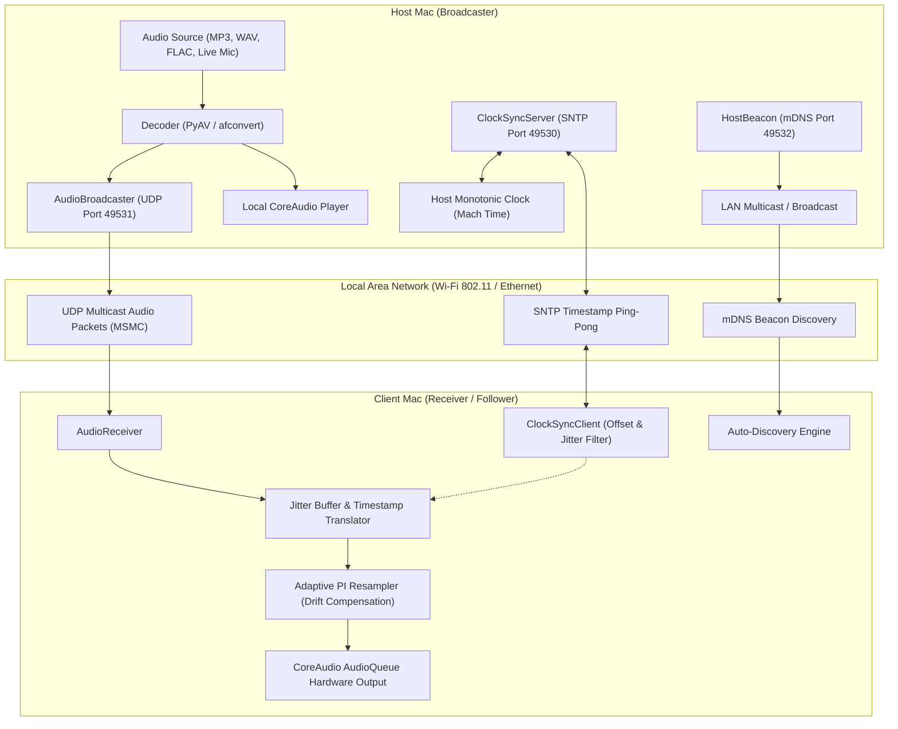

# mac-smusic: System Architecture & Engineering Blueprint

`mac-smusic` is an ultra-low latency, drift-compensated audio synchronization engine built for macOS. It allows two or more Macs connected to the same local area network (LAN / Wi-Fi) to discover each other, align their hardware playback clocks to microsecond accuracy, and play music or live audio in perfect phase lock.

---

## 1. System Topology

---

## 2. Key Modules & Data Flow

### 1. Monotonic Clock Synchronizer (`mac_smusic/clock.py`)
- Employs Apple's Mach absolute monotonic timer (`time.monotonic_ns()`), completely immune to wall-clock adjustments or NTP steps.
- Performs continuous round-trip timestamp exchanges between host and client over UDP port 49530.
- Implements a 16-sample sliding window min-RTT filter that selects the sample with lowest network transit delay, filtering out Wi-Fi queue jitter.
- Tracks clock drift rate in parts per million (PPM) to evaluate crystal oscillator variance.

### 2. Audio Packet Protocol (`mac_smusic/network.py`)
- Standardized binary frame header (32 bytes):
  - `Magic`: `0x4D534D43` (`MSMC`)
  - `Version`: `0x01`
  - `Channels`: 1 or 2
  - `SampleRate`: 44100 or 48000 Hz
  - `SequenceNumber`: 32-bit monotonic counter for packet loss detection
  - `HostPlayoutTimestamp`: 64-bit nanosecond timestamp indicating exact scheduled playout moment
  - `PayloadLength`: 32-bit byte count
  - `Reserved`: 64-bit padding / checksum
- Payload: 16-bit linear PCM signed little-endian stereo chunks.

### 3. Adaptive PI Resampler (`mac_smusic/resampler.py`)
- Continuously calculates queue depth error:
  $$e(t) = \text{TargetLeadTime} - \text{CurrentQueueTime}$$
- A Proportional-Integral (PI) regulator calculates micro-adjustments to the playback rate:
  $$\Delta r = K_p \cdot e(t) + K_i \int e(t) \, dt$$
- Employs linear interpolation across PCM samples to stretch or compress chunks by $\pm 0.01\%$, eliminating buffer underruns (clicks) and buffer overruns (echo) without human-perceptible pitch alteration.

### 4. Zero-KEXT Hardware Audio Player (`mac_smusic/player.py`)
- Connects directly to Apple's `AudioToolbox.framework` via Python `ctypes`, utilizing the native `AudioQueue` CoreAudio subsystem.
- Employs 4 circular hardware buffers of 4096 bytes each (1024 stereo frames), running on high-priority audio threads.
- Requires zero third-party kernel extensions, virtual sound cards, or system integrity compromises.

### 5. Zero-Configuration Bonjour Discovery (`mac_smusic/discovery.py`)
- Broadcasts JSON beacons across subnet broadcast (`<broadcast>:49532`) and multicast (`239.255.49.52:49532`).
- Enables `mac-smusic join` to locate active hosts in under 1 second without requiring IP lookups.
